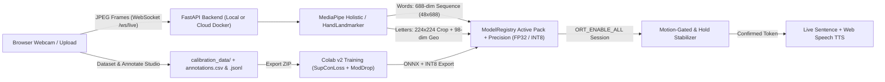

# Architecture & Scalability Design

This document describes the end-to-end inference architecture, dataset annotation pipeline, and pluggable **Model Pack** design for scaling to new vocabularies (e.g., Medical ASL, Emergency Signs) or other sign languages (e.g., **SgSL**, **BSL**).

---

## 1. End-to-End Inference & Active-Learning Flow



---

## 2. Pluggable Model Pack Architecture (`models/packs/<pack_id>/`)

All UI labels, ONNX input/output bindings, and classification heads adapt dynamically from `word_model_config.json` and `letter_model_config.json` rather than hard-coded label lists.

To add a new vocabulary domain or sign language without modifying application code:

1. Create `models/packs/<pack_id>/`, e.g. `models/packs/medical_asl/` or `models/packs/sgsl/`.
2. Add an optional `pack_manifest.json`:
   ```json
   {
     "name": "Medical ASL Pack",
     "domain": "Clinical Triage & Symptoms",
     "description": "Custom vocabulary trained via Dataset & Annotate Studio.",
     "word_onnx": "asl_words_conformer.onnx",
     "word_config": "word_model_config.json"
   }
   ```
3. Place the trained `asl_words_conformer.onnx` (and optional `asl_words_conformer_int8.onnx` + `word_model_config.json` with any number of classes `N` in `"labels": [...]`) inside the pack folder. If only words are overridden, the registry seamlessly inherits the default `A-Z` fingerspelling model (or vice versa).
4. Click **Reload** in the web UI or switch packs via the **Pack** dropdown (`POST /api/packs/select`).

---

## 3. Team Dataset Collection & Structured Annotation Schema

The **Dataset & Annotate** studio supports custom new sign labels (`allow_custom=True`), clip trimming (`trim_start_pct`, `trim_end_pct`), and per-sample signer & environment provenance saved into both `calibration_data/annotations.csv` and `calibration_data/annotations.jsonl`:

| Field | Description |
| :--- | :--- |
| `sample_id` | Unique timestamped identifier (supports Undo / Delete) |
| `mode` | `words` or `letters` |
| `label` | Normalized sign gloss or custom domain label |
| `signer_id` | Team contributor ID (ingested by Colab v2 `StratifiedGroupKFold` for strict signer-disjoint evaluation) |
| `lighting` | `normal`, `low_light`, `bright`, or `backlit` |
| `background` | `plain` or `cluttered` |
| `handedness` | `right`, `left`, or `both` |
| `num_frames` / `trim_start_pct` / `trim_end_pct` | Frame count and temporal boundary trim percentages |
